# Fine Line Process — Database ERD

The single source of truth for the schema is [`prisma/schema.prisma`](../prisma/schema.prisma).
This document is the human-readable map of it — regenerate the diagram mentally from the schema
file if they ever drift; the `.prisma` file wins.

## Design decisions

1. **Tenant partitioning.** Every table carries `organizationId`. On the models the app commonly
   traverses *from* an organization (User, Contact, Property, Lead, Pipeline, Campaign, Deal,
   Buyer, Document, Role, Team) it's a formal Prisma relation. On the ~40 detail/child tables
   (PhoneNumber, Note, Call, Foreclosure, ComparableSale, etc.) it's a plain indexed column —
   still mandatory, still filtered on by the service layer, just not a declared Prisma relation
   object, to avoid forcing ~40 array back-fields onto `Organization` for no query benefit.
2. **Audit columns.** `createdAt`/`updatedAt` are real, always present. `createdById`/`updatedById`
   are plain scalar strings, not relations — "who did this" is answered by `AuditLog`, not by a
   reverse join from `User`. Functional ownership (`assignedUserId`, `ownerUserId`, `authorUserId`,
   `handledByUserId`, `uploadedByUserId`) **are** relations because the app genuinely runs "my
   leads" / "my tasks" style queries against them.
3. **Soft deletion** (`deletedAt`) on Lead, Contact, Property, Deal, Document, Campaign, Buyer —
   records that must survive removal for audit, compliance, or undo. Pure join/detail rows
   hard-delete.
4. **Polymorphic association via nullable FK pairs**, not a generic `entityType/entityId` string
   column, for `Note` (lead/property/deal) and `TagAssignment` (lead/contact) — keeps referential
   integrity enforced by Postgres instead of the application.
5. **Money** is `Decimal(12,2)`, never `Float`.

## Entity groups (mirrors schema.prisma section headers)

```mermaid
erDiagram
    ORGANIZATION ||--o{ USER : employs
    ORGANIZATION ||--o{ ROLE : defines
    ROLE ||--o{ USER : "assigned to"
    ROLE ||--o{ ROLE_PERMISSION : grants
    PERMISSION ||--o{ ROLE_PERMISSION : "included in"
    ORGANIZATION ||--o{ TEAM : has
    TEAM ||--o{ TEAM_MEMBER : includes
    USER ||--o{ TEAM_MEMBER : "member of"

    ORGANIZATION ||--o{ CONTACT : owns
    CONTACT ||--o{ PHONE_NUMBER : has
    CONTACT ||--o{ EMAIL_ADDRESS : has
    CONTACT ||--o{ MAILING_ADDRESS : has
    ORGANIZATION ||--o{ PROPERTY : owns
    PROPERTY ||--o{ PROPERTY_OWNER : "owned via"
    CONTACT ||--o{ PROPERTY_OWNER : "owns via"

    ORGANIZATION ||--o{ PIPELINE : defines
    PIPELINE ||--o{ PIPELINE_STAGE : has
    ORGANIZATION ||--o{ LEAD : tracks
    LEAD }o--|| CONTACT : "primary contact"
    LEAD }o--o| PROPERTY : "about"
    LEAD }o--|| PIPELINE_STAGE : "sits in"
    LEAD }o--o| USER : "assigned to"
    LEAD ||--o{ TASK : has
    LEAD ||--o{ APPOINTMENT : has
    LEAD ||--o{ NOTE : has
    LEAD ||--o{ OFFER : receives
    OFFER ||--o| CONTRACT : becomes
    CONTRACT ||--o| DEAL : becomes
    LEAD ||--o| DEAL : "resolves to"
    DEAL }o--o| BUYER : "sold to"
    DEAL ||--o{ TRANSACTION : records

    LEAD ||--o{ CONVERSATION : has
    CONVERSATION ||--o{ CALL : contains
    CONVERSATION ||--o{ SMS_MESSAGE : contains
    CONVERSATION ||--o{ EMAIL : contains

    ORGANIZATION ||--o{ CAMPAIGN : runs
    CAMPAIGN ||--o{ CAMPAIGN_STEP : has
    CAMPAIGN ||--o{ CAMPAIGN_ENROLLMENT : enrolls
    LEAD ||--o{ CAMPAIGN_ENROLLMENT : "enrolled in"
    ORGANIZATION ||--o{ AUTOMATION : defines
    AUTOMATION ||--o{ AUTOMATION_STEP : has

    ORGANIZATION ||--o{ DOCUMENT : stores
    PROPERTY ||--o| FORECLOSURE : "may have"
    PROPERTY ||--o| TAX_SALE : "may have"
    TAX_SALE ||--o{ TAX_SURPLUS_CLAIM : "may yield"
    PROPERTY ||--o| PROBATE_CASE : "may have"
    PROPERTY ||--o| SHORT_SALE : "may have"
    PROPERTY ||--o{ LIEN : "may have"
    PROPERTY ||--o{ MORTGAGE : "may have"
```

## Full model index

| Group | Models |
|---|---|
| Identity / Tenancy / RBAC | Organization, User, Account, Session, VerificationToken, Permission, Role, RolePermission, Team, TeamMember, AuditLog, Notification |
| Contacts / Properties | Contact, PhoneNumber, EmailAddress, MailingAddress, Property, PropertyOwner |
| Sources / Campaigns / Tags / Custom Fields | LeadSource, Campaign, CampaignStep, CampaignEnrollment, Tag, TagAssignment, SmartList, CustomFieldDefinition, CustomFieldValue |
| Pipelines / Leads | Pipeline, PipelineStage, Lead, LeadStageHistory |
| Tasks / Appointments / Notes | Task, Appointment, Note |
| Communications | Conversation, Call, SmsMessage, Email, ComplianceEvent |
| Automations | Automation, AutomationStep, Webhook |
| Buyers / Offers / Contracts / Deals / Documents | Buyer, Offer, Contract, Deal, Vendor, MarketingCost, Transaction, Document |
| Specialized modules | Foreclosure, TaxSale, TaxSurplusClaim, MortgageSurplusClaim, ProbateCase, ShortSale, Lien, Mortgage, Auction, CreativeFinanceDeal, PropertyValuation, ComparableSale, RepairEstimate |

**Phase 1 wires**: Organization, User, Role, Permission, RolePermission, Team, TeamMember, Account,
Session, VerificationToken, AuditLog (login/user events only).

**Phase 2 wires**: Contact, PhoneNumber, EmailAddress, Property, PropertyOwner, Pipeline (default
only — custom pipeline management is Phase 3), PipelineStage, Lead, LeadStageHistory, Note, Tag,
TagAssignment, CustomFieldDefinition, CustomFieldValue (LEAD/PROPERTY entities only), LeadSource
(created ad hoc from free text on the Lead form, no dedicated management UI yet).

**Phase 3 wires**: Pipeline (multiple, template-driven), PipelineStage management (add/rename/
reorder/delete), Task, Appointment. `LeadStageHistory` (Phase 2) now also feeds the merged
activity-timeline read model in `src/lib/modules/activity/service.ts`.

**Phase 9 wires**: Foreclosure, TaxSale, TaxSurplusClaim, MortgageSurplusClaim, ProbateCase,
ShortSale, Lien, Mortgage, Auction, CreativeFinanceDeal, PropertyValuation, ComparableSale,
RepairEstimate — the last 13 tables that had sat in the schema since Phase 1 with no application
code. All are Property-scoped and surfaced on the existing `/properties/[id]` page rather than new
routes; see [05-mvp-plan.md](05-mvp-plan.md)'s Phase 9 breakdown.

This document's per-phase "wires" notes above stop at Phase 3 and don't individually narrate every
table Phases 4-8 wired (Conversation/Call/SmsMessage/Email, Automation/Campaign/Webhook,
Buyer/Offer/Contract/Deal/Document, etc.) — those are all IMPLEMENTED; see
[../STATUS.md](../STATUS.md) for the authoritative, kept-current phase-by-phase status and
[05-mvp-plan.md](05-mvp-plan.md) for each phase's detailed breakdown.

**Post-Phase-1 schema correction**: `CustomFieldValue` originally only had `leadId`/`contactId`
scalar FKs even though `CustomFieldEntity` already enumerated PROPERTY and DEAL — a gap caught
while wiring Phase 2's property custom fields. It now also has `propertyId` and `dealId`, with
matching back-relations on `Property` and `Deal`.

**Post-Phase-2 schema addition**: `Note` gained an optional `taskId` (plus `Task.notes[]`) so Task
"Comments" (source spec §7) reuse the existing Note model and its `NotesSection` UI instead of a
new comment system.
